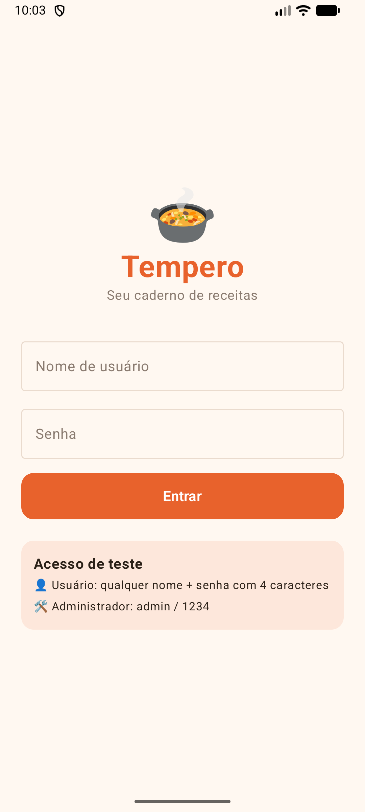
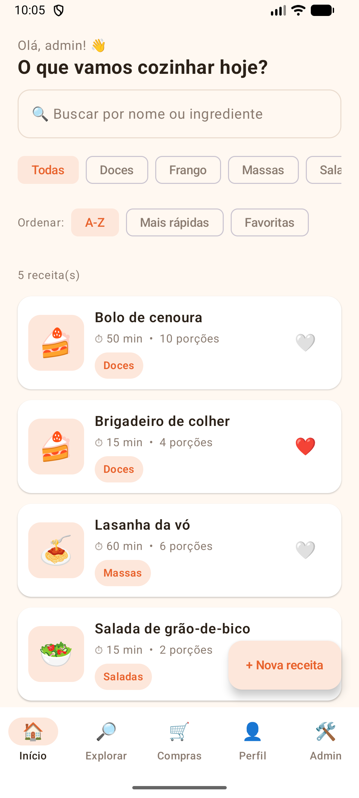
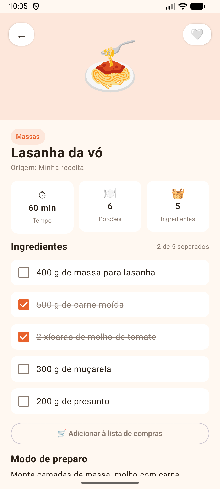
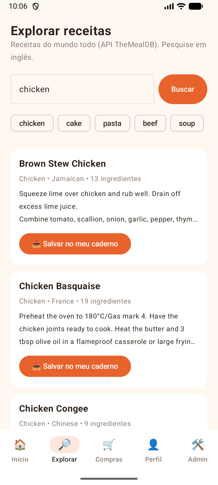
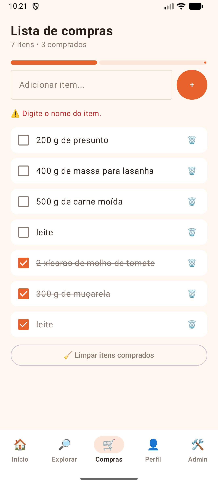
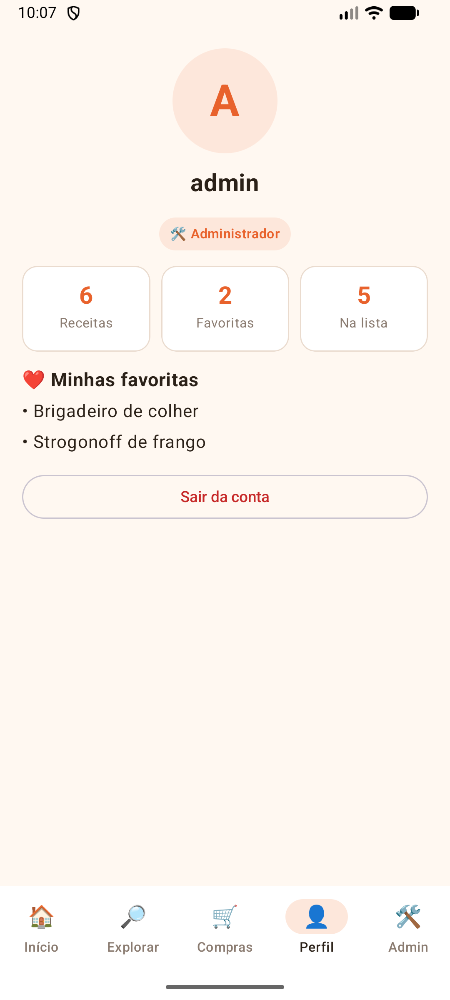
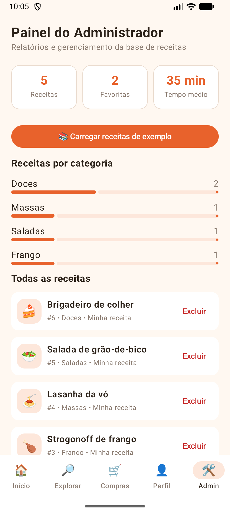
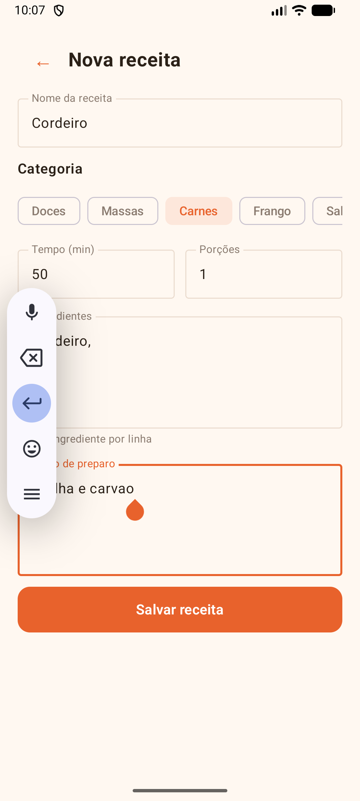

# 🍲 Tempero — Caderno de Receitas

Aplicativo Android desenvolvido em **Kotlin + Jetpack Compose** para o Trabalho Final (A1) de **Desenvolvimento de Aplicativos Móveis**.

O Tempero é um caderno de receitas digital: o usuário cadastra as próprias receitas, descobre receitas novas na internet, favorita, filtra, ordena e monta a lista de compras a partir dos ingredientes. Um perfil **Administrador** tem acesso a um painel com relatórios e gerenciamento da base.

**Autor:** Igor Alves

---

## 📱 Funcionalidades

| Tela | O que faz |
|---|---|
| **Login** | Login simulado que separa os perfis: `admin / 1234` → Administrador; qualquer outro nome (senha com 4+ caracteres) → Usuário |
| **Início** | Lista de receitas (LazyColumn) com busca, filtro por categoria e ordenação (A-Z, mais rápidas, favoritas) |
| **Detalhe** | Informações da receita, ingredientes com checkbox, favoritar, editar, excluir e enviar ingredientes para a lista de compras |
| **Formulário** | Criar e editar receitas com validação dos campos |
| **Explorar** | Busca receitas na API pública **TheMealDB** (Retrofit) e salva no caderno |
| **Compras** | Lista de compras com marcar como comprado, remover, barra de progresso e limpar comprados |
| **Perfil** | Dados do usuário, estatísticas, favoritas e botão de sair |
| **Admin** | (só Administrador) Relatórios por categoria, tempo médio, carregar receitas de exemplo e excluir receitas |

A navegação principal é feita por uma **Bottom Navigation Bar**. A aba **Admin** só aparece para o perfil Administrador.

---

## 🏗️ Arquitetura (MVVM)

```
com.igor.tempero/
├── MainActivity.kt                 → monta Banco → Repositories → Factory e chama a navegação
├── data/
│   ├── local/                      → Room
│   │   ├── Receita.kt              (@Entity 1)
│   │   ├── ItemCompra.kt           (@Entity 2)
│   │   ├── ReceitaDao.kt           (CRUD + Flow)
│   │   ├── ItemCompraDao.kt        (CRUD + Flow)
│   │   ├── AppDatabase.kt          (@Database, singleton)
│   │   └── ReceitasExemplo.kt
│   ├── remote/                     → Retrofit (TheMealDB)
│   │   ├── MealApi.kt
│   │   ├── RetrofitClient.kt
│   │   └── ReceitaRemota.kt
│   └── repository/                 → única porta de entrada dos dados (try-catch)
│       ├── ReceitasRepository.kt
│       └── ListaComprasRepository.kt
└── ui/
    ├── AppViewModelFactory.kt      → injeta os Repositories nos ViewModels
    ├── navigation/AppNavHost.kt    → NavHost (8 destinos) + Bottom Navigation Bar
    ├── login/       LoginViewModel + LoginUiState + TelaLogin
    ├── receitas/    ReceitasViewModel + ReceitasUiState + TelaInicio, TelaDetalhe, TelaFormReceita
    ├── explorar/    ExplorarViewModel + ExplorarUiState + TelaExplorar
    ├── compras/     ListaComprasViewModel + ListaComprasUiState + TelaListaCompras
    ├── admin/       AdminViewModel + AdminUiState + TelaAdmin
    ├── perfil/      TelaPerfil
    ├── componentes/ Composables reutilizáveis (CardReceita, Etiqueta, CardNumero...)
    └── theme/       Cores e tema
```

**Fluxo de dados:** `Room (DAO) → Flow → Repository → ViewModel (StateFlow<UiState>) → Tela`
**Eventos:** `Tela (clique) → ViewModel (onX()) → Repository → Room / API`

---

## ✅ Requisitos do trabalho

| Requisito | Onde está |
|---|---|
| MVVM com 4+ pacotes | `ui`, `data.local`, `data.repository`, `data.remote` |
| Mínimo 2 ViewModels com UiState próprio | 5 ViewModels: Login, Receitas, Explorar, ListaCompras, Admin |
| ViewModelFactory | `ui/AppViewModelFactory.kt` |
| Tratamento de exceções | try-catch nos Repositories; erro exposto no campo `erro` do UiState |
| Mínimo 2 @Entity | `Receita` e `ItemCompra` |
| Flow | `listarTodas()` / `listarTodos()` retornam `Flow<List<...>>`, coletados no `init {}` dos ViewModels |
| CRUD completo | Receitas: criar, listar, editar, excluir. Itens de compra: criar, listar, marcar (update), remover |
| Retrofit | `data/remote/MealApi.kt` — API TheMealDB |
| Mínimo 6 telas | 8 destinos no NavHost |
| Bottom Navigation Bar | `AppNavHost.kt` |
| filter / sortedBy / map com lambdas | `ReceitasViewModel.aplicarFiltros()`, `AdminViewModel.calcularRelatorio()` |
| LazyColumn | Início, Explorar, Compras, Admin, Detalhe |
| Controle de perfil (Admin) | `LoginViewModel` define o `Perfil`; aba e tela Admin só para administrador |

---

## 🛠️ Tecnologias

- Kotlin, Jetpack Compose, Material 3
- Room (androidx.room3) + KSP
- Retrofit + Gson
- Navigation Compose
- ViewModel + StateFlow + Coroutines

---

## ▶️ Como rodar

1. Clone o repositório e abra a pasta no **Android Studio**.
2. Aguarde o **Gradle Sync**.
3. Rode em um emulador ou celular (Android 7.0+).
4. Entre com `admin / 1234` → aba **Admin** → **Carregar receitas de exemplo**.

> A aba **Explorar** precisa de internet. As buscas na TheMealDB são em inglês (ex.: `chicken`, `cake`, `pasta`).

---

## 📸 Prints

| Login | Início | Detalhe | Explorar |
|---|---|---|---|
|  |  |  |  |

| Compras | Perfil | Admin | Formulário |
|---|---|---|---|
|  |  |  |  |

## 🎬 Vídeo

[Assista ao app funcionando](docs/video-tempero.mp4)
